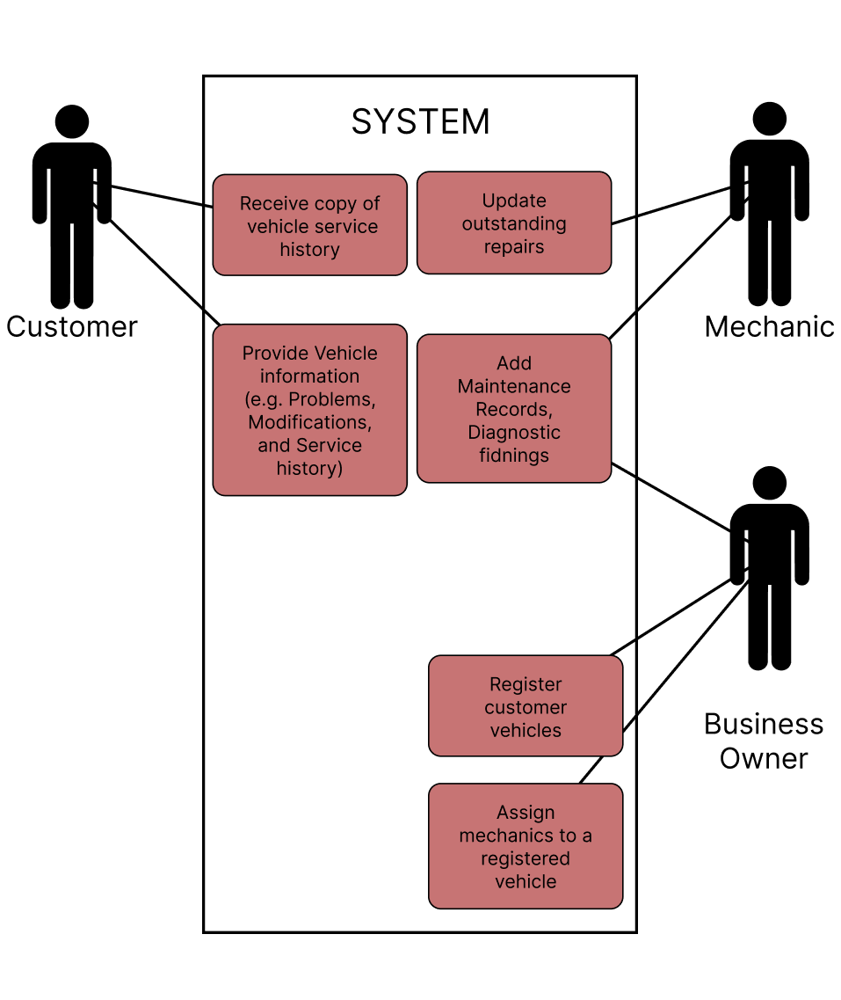

# Product Backlog

## Team Information

- Team name: NoMoreCtrlF  
- Project title: Mechanic's Notebook and Profiling tool for Regular Customers   
- Primary user group for the first release: Mechanics at independent repair shops in Iligan City   
- Format: User stories with one use case 

| Member | GitHub username | Personal CSC181 repository |
| :---- | :---- | :---- |
| Eddie F. Castre Jr. | eddie2252 | https\://github.com/eddie2252/CSC181-repository |
| Charlson Dale Fabrigar  | foober123  | https\://github.com/foober123/CSC181\_Github\_Repository |
| Daverie A. Gomonit  | Daverie | https\://github.com/Daverie/CSC181\_Repository |
| Ivan Jay A. Laguitao  | IvanJayLaguitao | https\://github.com/IvanJayLaguitao/CSC181-GitHub-repository |

## 1\. Interview Summary

| Code | Stakeholder role | Date | Method | Interviewer(s) |
| :---- | :---- | :---- | :---- | :---- |
| V1 | Mechanic, repair shop A  | 2026-10-24  | In Person | Charlson Dale Fabrigar  |
| V2 | Mechanic, repair shop B  | 2026-10-24  | In Person | Charlson Dale Fabrigar  |
| V3 | Customer | 2026-11-07 | In Person | Eddie F. Castre Jr. |

## 2\. From Interview Notes to Needs

| ID | Source | What we heard or saw | Underlying need | Requirement idea | Type |
| :---- | :---- | :---- | :---- | :---- | :---- |
| F1 | V1 | Some mechanics are assigned a regular customer's car because they worked on it before and know its failure pattern | A regular customer's car history should not depend on one mechanic  | Vehicle profile showing the usual mechanic and others who worked on it  | F |
| F2 | V1, V3 | When a worker is absent, the assigned work has to be rescheduled  | Work and vehicle history context must not be lost when the assigned mechanic is away. | Any mechanic can search for a vehicle and view its complete repair history and past notes. | F |
| F3 | V2, V3 | Keeps notes on regular customers' vehicles "primarily in my mind" and remembers what he worked on before  | Mechanic memory must be digitized and shared so shop knowledge isn't lost. | Structured repair note added to the vehicle's profile after each completed job.  | F |
| F4 | V2  | Memory already works for him: "I memorize models and I remember what I have worked on previously for regular customers" | Writing notes must cost little effort, or he has no reason to use them  | Note entry with few fields and one Save action  | Q |
| F5 | V1, V3  | V1: backjobs, repairs that don't go as planned. V3: when his mechanic was absent, a coworker said the starter problem would be fixed, but it was not, he called it "annoying and a waste of money"  | A repeat repair costs the customer time and money, and the shop needs to see what was already tried  | Backjob flag linked to the earlier repair, with the earlier record kept  | F |
| F6 | V1, V3 | V1: repairs take longer than expected because more parts turn out to be broken. V3: his usual mechanic asks "Is it the same thing again?"; with another mechanic he has to explain what is not working | A mechanic needs to see earlier problems and known broken parts before work starts  | Earlier problems and parts found broken shown at the top of the vehicle's page  | F |
| F7 | V1 | Income-generating vehicles are fixed first and personal cars second; some maintenance can be delayed (oil change), while other work (changing pads) is higher priority  | Staff need to see how a vehicle is used and what was postponed  | Label on the profile: UTILITY (income-generating work vehicle), COMMUTER (personal vehicle for daily travel), or PROJECT (vehicle being modified), and a postponed-work list  | F |
| F8  | V1 | Emergency cases (cars failing on the road) cost 4-12 hours, and jobs are switched when a utility vehicle is fixed first  | The shop's biggest losses are scheduling problems  | Out of scope this semester: scheduling and dispatch  | C |
| F9 | V2 | Regular customers are small businesses with trucks for hauling goods such as hardware and livestock. The trucks are old and exposed to the weather ("rain and shine"), and mostly the body parts fail together and he is most experienced with medium-duty delivery trucks and diesel pickups and SUVs  | One customer may own several vehicles, and demo data should look like the shop's real vehicles  | Several vehicles under one customer; fictional demo vehicles of these types  | F |
| F10 | V3 | Customer has to re-explain vehicle symptoms and past work whenever his primary mechanic is absent.  | Vehicle owners should not bear the burden of remembering and explaining past technical repairs.  | Customer-facing repair summary or instant history retrieval upon vehicle check-in.  | F |

### Assumption log

| ID | Assumption | Risk if wrong (High/Medium/Low) | How we will check it |
| :---- | :---- | :---- | :---- |
| A1 | A new mechanic spends about  4-6 hours diagnosing and learning a regular customer’s vehicle history when the primary assigned mechanic is absent.  | High | Ask mechanics and owners how long a mechanic takes to catch up on a car they haven’t worked on  |
| A2 | Mechanics at independent repair shops have sufficient digital literacy to operate a simple software interface without dedicated IT training.  | High | Ask mechanics which devices they use daily, then have one try a paper or clickable mock-up of the note form and time it  |
| A3 | Mechanics will consistently log repair notes after each job if the note entry is limited to no more than 4 fields and 1 Save action.  | High | Run a 1-week trial in a partner shop (e.g., Danny’s or Sanny’s Auto Repair) and track the percentage of completed repairs with logged notes.  |
| A4 | Vehicle owners are comfortable with the shop storing their vehicle’s repair history digitally, provided sensitive personal data (phone numbers and home addresses) is omitted.  | Medium | Survey regular shop customers (e.g., V3) on data privacy expectations during vehicle check-in.  |
| A5 | Displaying postponed maintenance items and previous failure notes at the top of a vehicle’s profile prevents duplicate diagnostic steps by replacement mechanics.  | Medium | Present scenario-based repair tasks to secondary mechanics with and without top-level vehicle quirk summaries and compare diagnostic accuracy.  |
| A6 | Mechanic absences and emergency roadside failures occur frequently enough (at least 1-3 times per week per shop) to cause systemic scheduling disruptions.  | Medium | Review shop job logs over a two-week period with shop owners to tally reassignment rates caused by worker absence or roadside dispatch.  |

## 3\. User Stories

| ID | User story | Source finding(s) | Epic | INVEST check |
| :---- | :---- | :---- | :---- | :---- |
| US-01 | As a mechanic, I want to view the vehicle’s usual assigned mechanic and any other mechanic who has worked on it, to understand the vehicle's issue. | F1 | Vehicle Profiling | Yes |
| US-02 | As a shop owner, I want to easily reassign scheduled work to an available mechanic , so that repairs are not delayed when a mechanic is absent. | F2 | System Admin | Yes |
| US-03 | As a mechanic, I want a note field to record the vehicle’s issue, so other members can see my own diagnosis instead of just staying in my mind. | F3 | Repair Logging | Yes |
| US-04 | As a mechanic, I want to look up a specific vehicle and view its notes, so that I can still fix the car correctly even if the assigned mechanic is absent. | F2 and F3 | Repair history | Yes |
| US-05 | As a mechanic, I want to record postponed maintenance on the vehicle's profile, so that the next assigned mechanic knows what needs to be done. | F7 | Maintenance | Yes |
| US-06 | As a mechanic, I want to link a repair attempt, so that I can see what was already tried and avoid making the same mistake. | F5, F6 | Repair history | Yes |
| US-07 | As a mechanic, I want to flag emergency repairs(cars that fail on the road), so that shops can see why scheduled work is delayed to manage other costumer’s expectations. | F8 | Repair Logging | Yes |
| US-08 | As a shop owner, I want to  register a customer with several vehicles under one profile, so that the shop can track all of a regular customer’s vehicles in one page . | F9 | Vehicle profiling | Yes |
| US-09 | As a customer, I want my vehicle’s history to be available even when my usual mechanic is absent, so that I avoid repeating my explanation to other assigned mechanics. | F2, F10 | Vehicle Profiling | Yes |
| US-10 | As a mechanic, I want to prioritize emergency road-failure cases, so that I can handle urgent dispatch without losing 4 to 12 hours. | F8 | System Admin | No |

### Epics and how we split them

| Epic | Split into | How we split it |
| :---- | :---- | :---- |
| Vehicle profiling | US-01, US-08, US-09 | **By data type** \- split into separate stories based on the information handled: mechanic assignment(US-01), customer profiles(US-08), and history visibility(US-09). |
| Repair Logging | US-07, US-03 | **By workflow step** \- separate stories for logging the standard diagnosis(US-03) and flagging emergency delays (US-07). |
| Repair History | US-06, US-04 | **By business rule** \- separate stories for viewing vehicle notes (US-04) and linking repairs(US-06). |
| System Admin | US-10, US-02 | **By happy path first** \- separate the work reassignment (US-02) from the complex emergency dispatch feature which is out of scope (US-10) |

### Stories we rewrote

1. Before: As a mechanic, I want to view the vehicle’s usual assigned mechanic and any other mechanic who has worked on it, to understand the vehicle's issue.  
   After: Split into mechanic assignment(US-01), customer profiles(US-08), and history visibility(US-09)   
   Reason:   
2. Before: As a mechanic, I want to prioritize emergency road-failure cases, so that I can handle urgent dispatch without losing 4 to 12 hours.  
   After: Kept it as US-10, but marked “INVEST” as “No”.   
   Reason: Because building a full dispatch system is too big for one sprint. We kept the simple reassignment (US-02) and set the emergency feature aside.

## 4\. Acceptance Criteria

### US-01: Maintenance Tracking

Acceptance criteria:

- [ ] All documented modifications, repairs and maintenance obligations are logged into the workbook prior to or after a repair  
- [ ] System must allow authorized mechanics to access and review a vehicle’s existing logbook history regardless of the previous mechanics who previously performed repairs  
- [ ] Mechanics can flag vehicles with aftermarket modifications to inform future mechanics who have to repair it in later shop visits (unhappy)

Scenario 1: 

```
Given: Mechanic completed a car repair 
When:  Mechanic records details of repair 
Then:  System saves repair record and record is now readable to authorized mechanics
```

Scenario 2: Undocumented Modifications

```
Given: Customer brings in a project car containing aftermarket modifications that are not documented in the log book
When: A mechanic inspects its history using the logbook and flags the modifications
Then: The logbook flags the vehicle as a project car and then a warning is visible to other mechanics when they inspect its service history
```

### US-02: Accumulated Repair History

Acceptance criteria:

- [ ] Logbook allows mechanics to read a customer’s vehicle maintenance and repair history before diagnosing or repairing  
- [ ] The logbook must maintain a chronological and cumulative record of service activity. Adding new records must not replace previous records  
- [ ] Backjob records must be retained in the mechanic's logbook history and must not be overwritten or deleted when a subsequent repair is performed. A corrective repair is able to refer to a backjob (Unhappy)

Scenario 1: Accessing Service History

```
Given: Customer has a car with multiple documented repairs in the logbook and its assigned mechanic is absent for the day
When: A different mechanic is assigned to work on that vehicle
Then: The mechanic view all previous documented repairs before performing additional work
```

Scenario 2: Recording a backjob

```
Given: There is a backjob in the logbook 
When: Mechanic performs a rework on the backjob
Then: Original Backjob remains in history and then corrective repair is linked to it
```

### 

## 5\. Quality Requirements and Constraints (EARS)

| ID | Requirement | EARS pattern | Type | Source | Number agreed with |
| :---- | :---- | :---- | :---- | :---- | :---- |
| NFR-01 | When a mechanic submits a search by plate number or customer name, the system shall list the matching vehicles within 2 seconds for up to 200 profiles.  | Event-driven | Quality | F2 | Not yet agreed |
| NFR-02 | The system shall let a mechanic save a repair note using no more than 4 fields and 1 Save action.  | Ubiquitous  | Quality | F4 | Not yet agreed |
| NFR-03 | If a required field is empty, then the system shall not save the entry and shall name the missing field.  | Ubiquitous | Quality | F3 | N/A |
| NFR-04 | The prototype shall contain only fictional vehicles, customers, and mechanics.  | Ubiquitous  | Constraint | F9 | N/A |
| NFR-05 | While a vehicle has postponed work items, the system shall show them above the repair history.  | State-driven  | Quality  | F7 | N/A |
| NFR-06 | The system shall keep every saved note and shall not overwrite or delete a note when a later repair is saved.  | Ubiquitous  | Quality  | F5 | N/A |
| NFR-07 | The prototype shall store a customer's name only and shall not store phone numbers or home addresses.  | Ubiquitous  | Constraint | F3 | N/A |

## 6\. Use Case

### Use-case diagram



### UC-01: Logging a Repair

| Field | Description |
| :---- | :---- |
| Primary actor | Mechanic. One who logs repairs |
| Precondition | At least 1 customer’s vehicle is registered by the business owner and at least 1 mechanic is assigned to it |
| Main success scenario | 1\. Business owner assigns a vehicle to a mechanic   2\. Logbook displays a list of vehicles   3\. Mechanic searches by license plate   4\. Mechanics selects a vehicle   5\. Mechanic inspects repair history  6\. Mechanic performs repairs and maintenance  7\. Mechanic logs complete repair and maintenance details   |
| Extensions | 2.a Vehicle flagged as a modified vehicle System displays a warning that besides the vehicle list that this specific vehicle contains modifications 6.a Mechanic identifies an aftermarket modification Mechanic logs the aftermarket modification and vehicle is now flagged as a containing aftermarket modifications   |
| Postcondition | System saves the repair and System updates vehicle’s service history |
| Stories covered | US-01 |

## 7\. Story Map

|  | \[Journey step 1\] | \[Journey step 2\] | \[Journey step 3\] | \[Journey step 4\] |
| :---- | :---- | :---- | :---- | :---- |
| **Release 1 (MVP)** | US-08 (Register customer/vehicles)  | US-04 (Look up vehicle) US-01 (View usual mechanics)  | US-09 (View history when mechanic is absent)  | US-03 (Record issue in note field) |
| **Release 2** | US-02 (Reassign scheduled work) | US-06 (Link backjob to earlier repair) | US-05 (Record postponed maintenance) |  |
| **Later** | US-10 (Prioritize emergency dispatch) |  |  |  |

## 8\. The Ordered Backlog

| Rank | Story | MoSCoW | Size (S/M/L) | Value / effort quadrant | Sprint |
| :---- | :---- | :---- | :---- | :---- | :---- |
| 1 | US-08 Register a customer with several vehicles under one profile | Must | M | Big bet  | Sprint 1 |
| 2 | US-03 Record a vehicle’s issue in a note field | Must | S | Quick win  | Sprint 1 |
| 3 | US-04 Look up a vehicle and view its notes  | Must | M | Big bet  | Sprint 1 |
| 4 | US-01 View a vehicle’s usual and other mechanics  | Must | S | Quick win  | Sprint 1 |
| 5 | US-06 Link a repair attempt (backjob) to the earlier repair  | Should | M | Big bet  | Sprint 1 |
| 6 | US-05 Record postponed maintenance on the vehicle profile  | Should | S | Quick win  | Sprint 2  |
| 7 | US-02 Reassign scheduled work to an available mechanic  | Should | M | Big bet  | Sprint 2 |
| 8 | US-07 Flag emergency repairs  | Could  | S | Fill-in  | Later  |
| 9 | US-09 Customer’s history available when the usual mechanic is absent  | Could  | S | Fill-in  | Later  |

### How we ordered it

US-08 is first because every other story depends on a registered customer and vehicle. US-03 and US-04 come next because they form the core of the notebook: mechanics write notes down (F3) and any mechanic can retrieve them (F2), which is the shop’s main problem of knowledge living only in one mechanic’s head. US-01 completes the Release 1 path by showing who usually works on a vehicle. The Should stories (backjob links, postponed work, reassignment) add real value but need the core records to exist first. US-10 is a Won’t because dispatch and scheduling are out of scope this semester (F8), and it stays in the backlog so it isn’t lost. US-09 largely overlaps with US-04, so it is ranked low.

### Capacity check

| Question | Answer |
| :---- | :---- |
| How many Must-have stories, and their total size? | 4 Must-haves: 2 × M \+ 2 × S (US-08, US-04 are M; US-03, US-01 are S).  |
| Do the Must-haves fit in about 60% of our time for two sprints? | Yes. Only 4 small or medium stories sit in Sprint 1, which leaves room for testing, rework, and the Sprint 2 Should stories. *Confirm against your actual member hours.*  |
| Do the Release 1 stories form one complete path through the core workflow? | Yes. Register vehicle (US-08), find and view its notes (US-04), see its mechanics (US-01), and log the repair note (US-03).  |
| Are all L-sized Must-have stories split? | Yes. There are no L-sized Must-haves. The only L story (US-10) is a Won’t and is kept, not deleted.  |

## 9\. Definition of Done

- [ ] The story’s acceptance criteria, including the unhappy path, all pass when tested by someone other than the person who built it.  
- [ ] The feature works in the running prototype end to end (for example, a note saved on one screen shows up on the vehicle’s profile page).  
- [ ] The prototype uses only fictional vehicles, customers, and mechanics, and stores no phone numbers or home addresses (NFR-04, NFR-07).  
- [ ] Required-field errors name the missing field, and previously saved notes are never overwritten or deleted (NFR-03, NFR-06).  
- [ ] At least one other team member reviewed the code or design, and the change is committed to the shared repository.  
- [ ] Any change to the story’s behavior is reflected in the backlog (criteria, scenarios, traceability).

## 10\. Traceability Table

| Story | Problem or goal it addresses | Source finding(s) | Test cases (Week 9\) |
| :---- | :---- | :---- | :---- |
| US-08  | Track all of a regular customer’s vehicles under one profile  | F9  |  |
| US-03  | Move mechanics’ memory into shared, written notes  | F3, F4  |  |
| US-04  | Let any mechanic find a vehicle and read its history when the usual mechanic is absent  | F2, F3  |  |
| US-01  | Show the usual mechanic and others who worked on a vehicle  | F1  |  |

Gaps found: F8 (emergency cases and scheduling losses) only has a Won’t story (US-10), because it is out of scope this semester. F6 (earlier problems shown at the top of the vehicle page) has no Must-have story. It is covered by Should story US-06 and requirement NFR-05. US-09 duplicates much of US-04, so it was ranked as a Could rather than removed. 

## 11\. Validation

### Team review

| Problem found | Story or requirement | How we fixed it |
| :---- | :---- | :---- |
| User story was too large and covered multiple concerns (mechanic assignment, customer profiles, and history visibility), violating the INVEST principle of being small and independent. | US-01  | Split the original idea into separate stories: US-01 (mechanic assignment visibility), US-08 (customer with multiple vehicles), and US-09 (history visibility).  |
| Emergency dispatch and prioritization required scheduling and workflow management beyond the scope of one sprint, making the story too large and difficult to estimate.  | US-10  | Kept the story in the backlog but marked INVEST as "No" and classified it as a Won’t-have/out-of-scope feature for this semester. |
| Customer privacy requirements were not clearly stated in the backlog, creating a risk of storing unnecessary personal information. | NFR-07  | Added a constraint specifying that only customer names are stored and that phone numbers and home addresses must not be recorded in the prototype.  |

### Stakeholder walk-through

| Stakeholder | Date | What they said | What we changed |
| :---- | :---- | :---- | :---- |
| V1 (Mechanic, Repair Shop A)  | 2026-11-08  | Being able to quickly see previous repairs is more important than scheduling features because mechanics often cover for absent coworkers.  | Kept US-04 as a Must-have story and moved scheduling-related work lower in priority.  |
| V3 (Customer)  | 2026-11-08  | Customers do not want to repeatedly explain the same vehicle problems whenever a different mechanic handles the vehicle.  | Confirmed the importance of vehicle history visibility and retained US-09 in the backlog while ensuring US-04 supports this need in Release 1\. |

## 12\. Open Questions for Sprint 1

1. When a regular customer's usual mechanic is absent, how long does another mechanic take to catch up, and how often does that happen?   
2. Will mechanics write a note after every job, and on which device and at what moment?   
3. Are customers comfortable with a shop keeping a record of their vehicle, and what would they not want recorded? 

## 13\. Member Contribution Record

| Member | Interviews or analysis | Stories, criteria, or use case | Review or validation |
| :---- | :---- | :---- | :---- |
| Eddie F. Castre Jr. | Interviewed V3, a customer and wrote up his answers and the realizations from them. Wrote section 1 and 2  | Wrote section 5  Drafted section 12  | Reviewed the assumption log and revised the wording of A1 and A2   |
| Ivan Jay Laguitao | Analyzed team’s finding to determine story mapping | Wrote section 3 and story map | Reviewed stories against INVEST checklist |
| Daverie A. Gomonit | Ordered stories and assessed which to include in Sprint 1\. Determined criteria/definition for done | Wrote Section 8 | Reprioritized stories and addressed misalignment. Asked  for stakeholders’ opinion and validation. |
| Charlson Fabrigar | Thought of common edge cases in vehicle repair like Backjobs and Aftermarket Modifications | Wrote Section 4 & 6 | Asked stakeholders’ opinion and context for the job |

## 14\. References

None

## 15\. Team AI Use Declaration

Select one option:

- [ ] No generative AI tools were used by any member in preparing this submission.  
- [x] One or more members used generative AI tools. Details are provided below.

| Member who used AI | Tool | Purpose and sections assisted | How output was checked or revised |
| :---- | :---- | :---- | :---- |
| Charlson Fabrigar | GPT-6 | Purpose: Worded Mechanic and Blue Collar jargon into a more academic register Sections: Use Case Diagram and Given-When-Then | Check if groupmates can understand terms without me defining them |
| Eddie F. Castre Jr. | Claude | Help word the interview findings and drafted a format in ([interview.md](http://interview.md)) and help set working numbers for the quality requirements. | Compared the findings with the interview notes |
| Daverie A. Gomonit | Gemini | Helped in pinpointing potential problems that are in need for reevaluation and validation.  | Compared output against interview notes and story map. |
|Ivan Jay Laguitao | Gemini | Purpose: Helped format the user stories to follow the INVEST criteria. Sections: 3\. User Stories, Epics and how we split them, Stories we rewrote, and Story map.	 | Ensures every story accurately cites the correct finding (F1–F10). |

### Main prompts or interaction summary

Eddie: I shared our interview notes with claude and  to refine the raw data and ask to it to merge it findings and recommend number for the quality requirements  

We acknowledge that AI-generated suggestions are not evidence of actual stakeholder interviews, feedback, or verified user needs. Every finding in Section 2 and every walk-through in Section 11 comes from a real person we spoke to or observed. We remain responsible for the accuracy and explainability of this submission.

## 16\. Team Confirmation

We confirm that this document reflects our team's agreed-upon product backlog. All members listed below reviewed the final version, and each member will upload the same Markdown file to their personal CSC181 repository.

| Member | Reviewed final version |
| :---- | :---- |
| Eddie F. Castre Jr. | Yes |
| Daverie A. Gomonit | Yes |
| Ivan Jay Laguitao| Yes  |
| Charlson Fabrigar | Yes |

## Submission Checklist

- [x] Interviews cover at least two stakeholder groups, with sources coded and no personal information.  
- [x] The needs table has at least 8 findings, each labelled F, Q, or C.  
- [x] Assumptions are recorded separately from evidence.  
- [x] There are 10 to 15 user stories, each with a real role, a "so that", and at least one finding.  
- [x] Epics are split, and at least two rewrites are recorded.  
- [x] Every story has at least 3 acceptance criteria, including an unhappy path, with no weak words.  
- [x] Every Must-have story has at least 2 Given–When–Then scenarios.  
- [x] At least 3 quality requirements or constraints use EARS patterns.  
- [x] One use case has a diagram, a main success scenario, and at least 2 extensions.  
- [x] The story map has a Release 1 line that crosses every journey step.  
- [x] Every story has a MoSCoW label and a size, and the backlog is in one order with no ties.  
- [x] Must-haves fit in about 60% of capacity. Won't-have stories are kept, not deleted.  
- [x] A Definition of Done is included.  
- [x] The traceability table covers every Must-have story.  
- [x] The team review and the stakeholder walk-through are recorded.  
- [x] Contributions, references, and AI use are declared.  
- [x] All members reviewed the same final document.  
- [x] Each member saved the file as `activities/product-backlog.md`, with images in `activities/backlog-images/`.  
- [x] Each member committed and pushed their copy to their personal repository.  
- [x] Each member submitted their own GitHub file link through MOLE before November 11, 2026 23:59:59.
